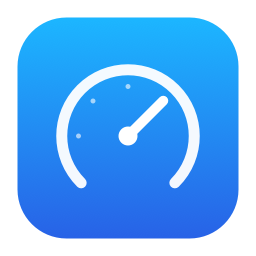
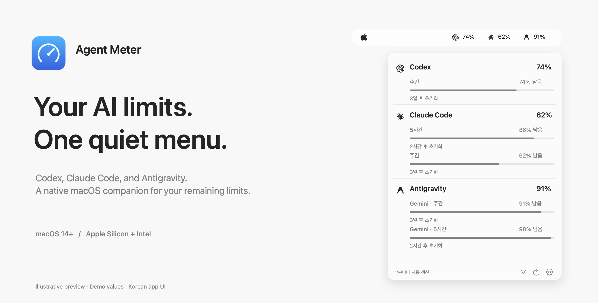
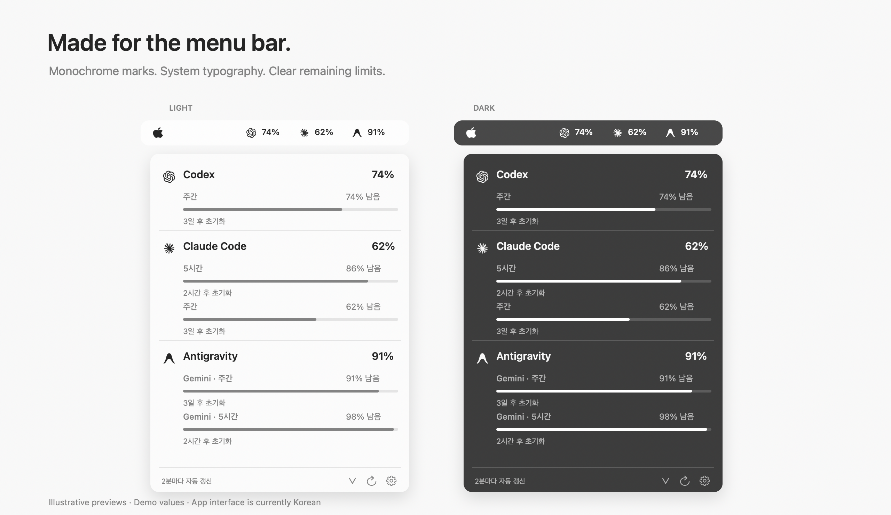

<p align="center">
  
</p>

<h1 align="center">Agent Meter</h1>

<p align="center">
  <strong>Your AI limits. One quiet menu.</strong><br>
  A native macOS menu bar app for Codex, Claude Code, and Antigravity.
</p>

<p align="center">
  
  
  
  
</p>

<p align="center">
  <a href="https://github.com/carter51200/agent-meter/releases/download/v0.3.2/Agent-Meter.zip"><strong>Download for macOS</strong></a>
  &nbsp;·&nbsp;
  <a href="https://github.com/carter51200/agent-meter/releases/tag/v0.3.2">Release notes</a>
  &nbsp;·&nbsp;
  <a href="https://github.com/carter51200/agent-meter/issues">Report an issue</a>
</p>



Keep your remaining account limits in view without leaving your work. Agent Meter puts three tools in one ordered menu bar item, with monochrome provider icons, period-specific quotas, and reset times.

> **Preview release:** the app interface is currently Korean. The download supports macOS 14+ on Apple Silicon and Intel. It is ad hoc signed, but is **not Developer ID signed or Apple notarized**. Antigravity support is experimental.

## A small app, a clear view

- **One place for three tools.** Codex → Claude Code → Antigravity, always in that order.
- **Remaining limits at a glance.** Each menu bar percentage is the lowest remaining quota returned for that provider.
- **Native macOS menus.** System typography, separators, progress indicators, and submenus for settings and model details.
- **Light and dark appearance.** All provider marks use monochrome template images.
- **Automatic refresh.** Checks every two minutes and again after your Mac wakes.
- **Optional launch at login.** Disabled until you enable it in settings.



*The images are documentation illustrations with fixed demo values, not screenshots of a personal account. They reflect the app's Korean interface and monochrome visual style.*

## Install

1. [Download Agent-Meter.zip](https://github.com/carter51200/agent-meter/releases/download/v0.3.2/Agent-Meter.zip) and unzip it.
2. Move **Agent Meter.app** to **Applications**. Quit an older copy before replacing it.
3. Launch the app and connect the tools you use.

You do not need Xcode to run the downloaded app. If macOS blocks this preview, review the app in **System Settings → Privacy & Security** before allowing it to open.

Every Mac uses its own local sign-in. Installing on a second Mac does not copy credentials from the first.

## Connect your tools

| Tool | Sign in | How Agent Meter reads usage |
| --- | --- | --- |
| **Codex** | Run `codex login` and sign in with your ChatGPT account. | Reads the local Codex login and requests account usage. API-key-only authentication does not expose subscription quotas. |
| **Claude Code** | Run `claude`, then `/login`. Use the app's Claude connection action if macOS needs Keychain approval. | Reads Claude Code's OAuth credentials. A CLI fallback can read `/usage` from a folder you have already trusted. |
| **Antigravity** · experimental | Sign in to `agy`, finish its initial setup, then select an already trusted folder through the app's CLI connection action. | Opens a temporary CLI session to read `/usage`. Without a configured folder, it attempts to read the running Antigravity local server. |

The settings menu is labeled **설정**. Claude's Keychain connection action is **Claude Code 연결…**; the separate CLI connection actions let you select a workspace folder.

### What the numbers mean

These are **account-wide remaining quotas**, not this Mac's token count or API spending. The periods and model groups depend on what each service returns.

- **`74%`** means 74% remains in the provider's most constrained measured quota.
- **`—`** means usage could not be read. Missing data is never shown as zero or full availability.
- The detail menu shows available session, weekly, or model-specific limits and reset times.
- During refresh, the previous measurement remains visible. If a read fails, an explanation replaces it.

Subscription plan names are not displayed.

## Privacy and connection behavior

- **No bundled credentials.** Releases contain the app and its resources, not authentication files, account logs, or personal workspaces.
- **No separate analytics or advertising code.** The app's direct usage requests go to the relevant provider or the local server at `127.0.0.1`.
- **Read-only credential access.** Agent Meter does not copy, store, modify, or sync your provider credentials. Explicitly connecting Claude may prompt for Keychain access; background refresh does not wait for an approval dialog.
- **Bounded CLI sessions.** The CLI fallback sends `/usage` only, requests no model inference, and stops its own temporary session. It does not accept folder-trust prompts. The provider CLI may perform its own login refresh, setup, or logging.
- **Connection safeguards.** Remote HTTPS certificates are verified and redirects are refused. The local Antigravity connection accepts its self-signed certificate only on `127.0.0.1`.
- **Clean release binaries.** The build script strips debug and local symbols so build-machine home paths are not embedded in the shipped executable.

Provider APIs and CLI screens can change. Account integrations were checked on the development Mac; installation and sign-in on other Macs still need separate verification. This preview has not had an independent security audit.

## Build from source

Requires macOS and Xcode Command Line Tools with Swift 6 or later.

```sh
swift run ParserChecks
zsh scripts/build-app.sh
open "dist/Agent Meter.app"
```

The build produces a universal app and `dist/Agent-Meter.zip`. The parser checks cover quota periods, missing or invalid data, model groups, reset dates, and terminal redraws.

<details>
<summary>Diagnostics and documentation artwork</summary>

```sh
"dist/Agent Meter.app/Contents/MacOS/AgentMeter" --check
```

Diagnostics omit account identity and authentication tokens. Usage values are still account data; review them before sharing.

| Option | Purpose |
| --- | --- |
| `--check --connect-claude` | Allow an explicit Claude Keychain prompt during diagnostics. |
| `--workspace /absolute/path` | Save an already trusted, signed-in folder for both CLI integrations. |
| `--check --force-cli` | Check the Claude and Antigravity CLI fallback paths. |
| `--preview` | Open a separate preview window showing actual usage. |

When launched from a terminal, `CODEX_HOME` and `CLAUDE_CONFIG_DIR` can override the respective configuration directories.

To regenerate the documentation illustrations:

```sh
swift scripts/render-readme.swift
```

This renderer uses fixed example values and does not read credentials or contact providers.

</details>

## Credits

Provider protocol research references [CodexBar's provider documentation](https://github.com/steipete/CodexBar/tree/main/docs). Agent Meter's implementation and interface were written for this project.

- **Codex/OpenAI mark:** [CodexBar's monochrome resource](https://github.com/steipete/CodexBar/blob/main/Sources/CodexBar/Resources/ProviderIcon-codex.svg). Its MIT license is included in `Assets/CodexBar-LICENSE.txt` and in the app bundle.
- **Claude mark:** the official app's `TrayIconTemplate@2x.png` resource.
- **Antigravity mark:** [Google's official press assets](https://antigravity.google/press).
- **Agent Meter icon and documentation artwork:** drawn with AppKit in this project.

Provider logos identify the services. Agent Meter is an independent project and is not affiliated with or endorsed by the providers.
